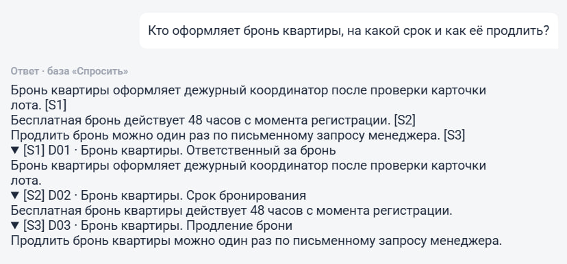

# Помощник для менеджеров по продаже недвижимости

«Кто оформляет бронь квартиры, на какой срок и как её продлить?» Чтобы ответить клиенту, менеджеру нужны сразу три правила. Мы разрабатываем чат, который находит их в документах отдела продаж, собирает ответ и показывает, откуда взят каждый факт. Цель нашей студенческой исследовательской работы — помочь новым сотрудникам быстрее осваивать рабочие процедуры и самостоятельно находить ответы на вопросы клиентов.

## Контрольная точка 1. Задача и прототип

На первом этапе мы описали ситуации, в которых менеджеру нужна помощь, и подготовили макет чата для компьютера и телефона. В нём два режима: «Спросить» для вопросов о рабочих процедурах и «Продавать» для подготовки к разговору с клиентом. Например, в первом режиме менеджер уточняет условия брони, а во втором — как ответить покупателю на возражение по цене.

По макету мы сделали интерактивный прототип. В нём можно было задать вопрос, увидеть ожидание ответа или ошибку и повторить запрос. Ответы тогда имитировались. [Макет интерфейса (PDF)](Service/references/mockup/view.pdf) · [Описание задачи и целей исследования](docs/product-context.md)

## Контрольная точка 2. Работающий чат и проверка на 15 вопросах

Для этой точки мы подготовили 30 учебных документов — по 15 на каждый режим. Для каждой базы написали собственный индекс BM25. Когда менеджер задаёт вопрос, поиск выбирает документы из базы текущего режима, а языковая модель `openai/gpt-oss-20b` через Groq формирует ответ по найденному тексту. Источники можно раскрыть прямо в чате.

### Пример из учебной базы

> Кто оформляет бронь квартиры, на какой срок и как её продлить?


У каждого условия свой источник. По документу **D01** бронь оформляет дежурный координатор после проверки карточки лота. В **D02** указан срок — 48 часов с момента регистрации. По **D03** бронь можно продлить один раз по письменному запросу менеджера.



### Результаты проверки

Мы заранее составили 10 вопросов с ответами в корпусе и 5 вопросов-ловушек. Для каждого обычного вопроса отметили три документа, необходимые для полного ответа. Например, на вопрос о порядке продления брони ответ есть, а на вопрос «Сколько стоит продление брони квартиры в рублях?» чат сообщил, что цена в документах не указана.

В пробном прогоне 21 ноября 2026 года поиск и позицию первого релевантного документа оценивали по первым пяти результатам.

| Что проверяли | Результат |
|---|---|
| Все ли нужные документы попали в первую пятёрку (Recall@5) | 1,00 — для каждого из 10 вопросов нашлись все три документа |
| Как высоко оказался первый нужный документ (MRR@5) | 1,00 — во всех 10 случаях он занял первое место |
| Сколько ответов содержали все факты из эталона (Accuracy) | 10 из 10 |
| Сколько ловушек завершились корректным отказом (Correct Rejection Rate) | 4 из 5 |

На пятой ловушке, о зарядке для электромобиля на парковке, Groq вернул ошибку лимита. Система не дала ответа, поэтому этот случай получил ноль баллов. Результаты относятся к учебному корпусу и предварительной оценке ответов. [Полный отчёт: 15 вопросов, выдача поиска, фактические ответы, эталоны и разбор ошибок](reports/checkpoint-pilot.md)

## Локальный запуск

Понадобятся Docker с Compose и личный [API-ключ Groq](https://console.groq.com/keys). После клонирования репозитория создайте в его корне файл `.env` по образцу [.env.example](.env.example) и впишите ключ после `GROQ_API_KEY=`. Из той же папки выполните:

```sh
docker compose up --build -d
```

Откройте [чат](http://localhost:5173/), выберите «Спросить» и задайте вопрос о брони из примера выше. Для остановки выполните `docker compose down`.

## Как повторить проверку

При запущенных контейнерах эта команда прогонит все 15 вопросов через поиск и Groq. Чтобы воспроизвести параметры отчёта, оставьте `RAG_TOP_K=5` в `.env`.

```sh
docker compose exec backend python benchmark.py --depth 5 --live
```

Команда выведет имя JSON-файла в папке `reports/`. Для проверки только поиска выполните ту же команду без `--live`: вызовов модели и расхода токенов в этом случае не будет.

Чтобы получить оценки ответов, сравните каждый ответ живого прогона с его эталоном (`reference`) и заполните поле `correct` значением `true` или `false`. Для обычного вопроса засчитывается полный ответ по источникам, для ловушки — обоснованный отказ. Ошибка сервиса получает `false`. Подставьте имя заполненного файла в команду ниже. Рядом появится файл `.scored.json` с четырьмя метриками.

```sh
docker compose exec backend python benchmark.py --score /reports/ИМЯ-ФАЙЛА.json
```
