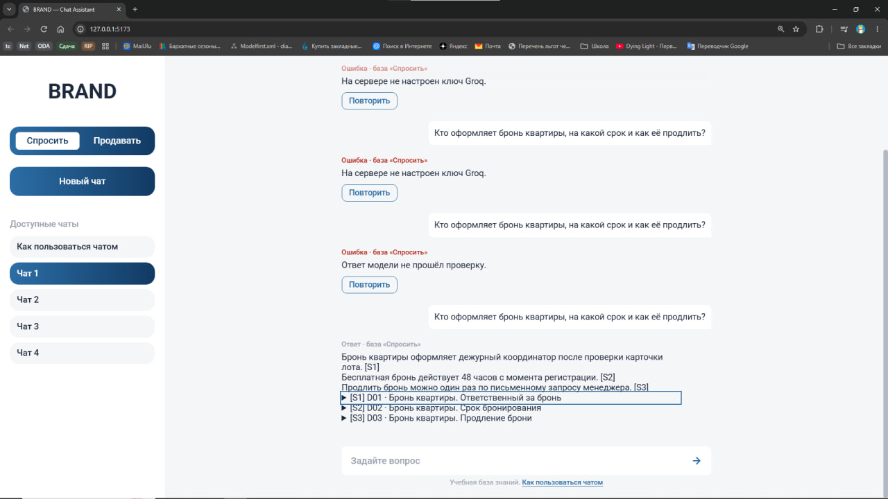

# Student-Research-Work-RAG-System

НИРС: помощник для менеджеров по продаже недвижимости. Менеджер задаёт вопрос обычным текстом, система находит ответ в документах компании (поиск BM25) и составляет по ним короткий ответ языковой моделью со ссылками на источники. Цель — быстрее вводить новичков в работу и меньше зависеть от опытных коллег.

**Впервые здесь? Начните с [обзора проекта простым языком](docs/overview.md)** и держите под рукой [словарь терминов и кодов](docs/glossary.md).

## Локальный запуск

В учебном корпусе 30 синтетических документов о работе отдела продаж. «Спросить» ищет в 15 регламентах, «Продавать» — в 15 материалах о беседе с клиентом. FastAPI строит отдельный BM25-индекс каждой базы и сохраняет их в томе Docker. Тексты вопросов и выбранных документов отправляются в Groq при запросе с совпадениями.

1. Установите Docker с Compose. Для ответов модели получите личный [ключ Groq](https://console.groq.com/keys).
2. Если в корне ещё нет `.env`, скопируйте туда [.env.example](.env.example) под именем `.env`. Впишите ключ после `GROQ_API_KEY=`. Модель по умолчанию — `openai/gpt-oss-20b`.
3. Выполните `docker compose up --build -d` из корня проекта. После изменения ключа повторите эту команду.
4. Откройте [чат](http://localhost:5173/) и в режиме «Спросить» задайте вопрос «Кто выдаёт ключи?». Под ответом можно раскрыть использованные документы. [Состояние API](http://localhost:5173/api/health) проверяет запуск приложения и загрузку индексов. Остановка — `docker compose down`.

## Что показать на контрольной точке

Все 15 фактических ответов или ошибок, ранжированные документы, эталоны и оценки собраны в [отчёте пробного прогона](reports/checkpoint-pilot.md). При глубине 5 получили Recall@5 = 1,00, MRR@5 = 1,00, Accuracy = 10/10 и Correct Rejection Rate = 4/5. На последней ловушке сработал лимит Groq.

**Q01 в чате.** Менеджер спрашивает, кто оформляет бронь квартиры, на какой срок и как её продлить. Внизу переписки виден успешный ответ, выше — предыдущие попытки во время настройки сервиса.



**Проверка ответа по документам.** D01 указывает, что бронь оформляет дежурный координатор, D02 устанавливает срок в 48 часов с момента регистрации, а D03 допускает одно продление по письменному запросу менеджера.


Для устной демонстрации подойдут следующие примеры. В первых двух раскройте источники под ответом. Третий пример проверяет, умеет ли модель признать, что конкретного факта в материалах нет.

| Режим | Вопрос для чата | Что проверить вместе с преподавателем |
|---|---|---|
| Спросить · Q01 | Кто оформляет бронь квартиры, на какой срок и как её продлить? | В D01–D03 указаны дежурный координатор, 48 часов с момента регистрации и однократное продление по письменному запросу менеджера. |
| Продавать · Q09 | Что спросить при подборе парковки, что показать на плане и какое предложение отправить? | В D25–D27 предложено уточнить длину автомобиля, показать путь до лифта и отправить карточки двух свободных мест с размерами. |
| Спросить · Q11 | Сколько стоит продление брони квартиры в рублях? | Документы описывают порядок продления. Его стоимость в рублях неизвестна. Ожидается отказ назвать сумму. |

Затем откройте заранее оценённый отчёт из `reports/`. На примере Q01 сравните `relevant` (эталонные ID), начало `ranked` (выдачу BM25), `context` (текст для модели) и `result` (ответ и источники). На Q11 покажите, почему тематически близкая выдача может привести к корректному отказу. В конце покажите четыре значения из `metrics` и кратко разберите ошибки конкретного прогона.

<details>
<summary>Все 15 вопросов для демонстрации и проверки</summary>

| ID | Режим | Вопрос | Эталонные документы или ожидаемый исход |
|---|---|---|---|
| Q01 | Спросить | Кто оформляет бронь квартиры, на какой срок и как её продлить? | D01, D02, D03 |
| Q02 | Спросить | Как записать клиента на осмотр квартиры, где встречаться и что взять? | D04, D05, D06 |
| Q03 | Спросить | Как проходит передача ключей: кто выдаёт, что подписать и сколько комплектов получает клиент? | D07, D08, D09 |
| Q04 | Спросить | Как подать заявку на ремонт, какой номер сохранить и когда ждать подтверждения? | D10, D11, D12 |
| Q05 | Спросить | Что взять на приёмку отделки, где отметить дефекты и кто согласует повторный осмотр? | D13, D14, D15 |
| Q06 | Продавать | Что уточнить при сравнении планировок, какой материал показать и что отправить после беседы? | D16, D17, D18 |
| Q07 | Продавать | Как разобрать возражение по цене: какой вопрос задать, что сравнить и чем закончить разговор? | D19, D20, D21 |
| Q08 | Продавать | С чего начать презентацию двора, какую схему показать и куда пригласить семью? | D22, D23, D24 |
| Q09 | Продавать | Что спросить при подборе парковки, что показать на плане и какое предложение отправить? | D25, D26, D27 |
| Q10 | Продавать | Как подготовить дистанционный показ, с чего начать трансляцию и что отправить после неё? | D28, D29, D30 |
| Q11 | Спросить | Сколько стоит продление брони квартиры в рублях? | Корректный отказ |
| Q12 | Спросить | В какие часы по воскресеньям открыта стойка для осмотра квартиры? | Корректный отказ |
| Q13 | Спросить | Какой штраф назначают за утерю ключей? | Корректный отказ |
| Q14 | Продавать | Какую скидку обещать после дистанционного показа? | Корректный отказ |
| Q15 | Продавать | Есть ли зарядка для электромобиля на каждом месте парковки? | Корректный отказ |

</details>

## Как повторить проверку

[Вопросы и эталоны](evaluation/cases.json) лежат отдельно от корпуса. Каждый обычный вопрос опирается минимум на три документа своего режима. Все пять ловушек размечены как вопросы без ответа. Для учебного прогона используются `RAG_TOP_K=5` и глубина MRR 5. Значения для сдачи согласуйте с руководителем, затем задайте первое в `.env`, повторите запуск Compose и передайте второе через `--depth`.

```sh
docker compose exec backend python -m unittest -v test_rag
docker compose exec backend python benchmark.py --depth 5
```

Вторая команда проверяет разметку и измеряет поиск без обращения к Groq. В [сохранённом пробном отчёте](reports/20261120T210345Z-2ef47ff6.json) Recall@5 и MRR@5 равны 1,0 на десяти обычных вопросах. Для проверки ответов на всех 15 вопросах выполните отдельную команду:

```sh
docker compose exec backend python benchmark.py --depth 5 --live
```
 Это отдельный прогон с максимум одним запросом к Groq на вопрос, без автоматических повторов. Файл появится в папке `reports/` проекта, команда напечатает его имя.

Для оценки ответов откройте JSON живого прогона. Для каждого вопроса сравните ответ и источники с `reference`, заполните `correct` значением `true` или `false`. Полный ответ должен содержать все обязательные факты без выдуманных условий. Для ловушки засчитывается явный обоснованный отказ. Техническая ошибка получает `false`. Сохраните файл и выполните:

```sh
docker compose exec backend python benchmark.py --score /reports/ИМЯ-ФАЙЛА.json
```

Рядом появится файл `.scored.json` с четырьмя метриками. Recall@k и MRR усредняются по 10 обычным вопросам, Accuracy — по их полным ответам, Correct Rejection Rate — по пяти ловушкам. До разметки живых ответов последние две метрики имеют значение `null`. В разборе ошибок сопоставьте эталонные ID с выдачей, затем текст переданного контекста с фактическим ответом.

## Куда смотреть дальше

- [Обзор проекта](docs/overview.md) — что, зачем и как, без служебных пометок.
- [Продукт и требования](docs/product-context.md) и [сценарии поведения](docs/behavior.md).
- [Решения и открытые вопросы](docs/decisions/README.md).
- [Карта проекта и трассируемость](docs/project-map.md).
- [Оглавление и правила оформления документации](docs/README.md).
- [Текущее рабочее состояние](Update/README.md).
- [Инструкции для ИИ-агентов](AGENTS.md).

Принцип работы: сначала спецификация, потом реализация. Исследование проверяет пользу системы; рост или стабильность продаж не являются гарантированным результатом.
