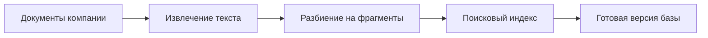
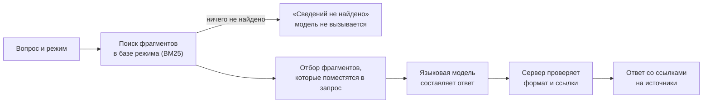

# Обзор проекта простым языком

Этот документ — пересказ для людей, которые впервые открыли репозиторий. Он ничего не решает и не заменяет спецификации. Если пересказ расходится с ними, верны спецификации. Незнакомые слова объяснены в [словаре](glossary.md).

Состояние на 2026-10-19.

## Что это за проект

Это научно-исследовательская работа студентов (НИРС): система-помощник для менеджеров по продаже недвижимости.

**Проблема.** Рабочие знания — регламенты, условия сделок, ответы на частые вопросы клиентов — часто хранятся в документах и в головах опытных сотрудников. Новичку трудно быстро найти нужное, и он отвлекает коллег.

**Идея.** Менеджер задаёт вопрос обычным текстом. Система находит подходящие места в документах компании и составляет по ним короткий ответ со ссылками на источники. Ссылки позволяют проверить, откуда взят ответ.

**Два режима.** Переключатель «Спросить / Продавать» выбирает, в какой базе знаний искать ответ: у каждого режима своя база. Что именно войдёт в каждую базу, пока не определено.

**Чем проект не является.** Система не принимает решения за менеджера, не работает с CRM и не обещает рост продаж. Влияет ли она на продажи, можно выяснить только отдельным долгим экспериментом, и он в эту работу не входит.

## Как это будет работать

Работа делится на два независимых процесса.

**1. Подготовка базы знаний — заранее, не через сайт.** Оператор (разработчик или исследователь) берёт разрешённые документы и запускает подготовку. Документы разбиваются на небольшие фрагменты, по ним строится поисковый индекс. Готовая версия базы публикуется целиком. Каждый режим собирается отдельно.

**2. Ответ на вопрос.**

Пояснения:

- **Поиск — BM25.** Это классический алгоритм, похожий на поисковик по документам: он ищет фрагменты с теми же словами, что в вопросе, и ставит выше самые подходящие. Смысл он не «понимает». Если вопрос сформулирован иначе, чем в документах, нужное может не найтись. Проверить, насколько это мешает, — одна из задач исследования.
- **Языковая модель** (LLM) получает только вопрос и найденные фрагменты. Она должна отвечать по ним, а не «из головы». Какая модель будет использоваться, ещё не выбрано.
- **Каждый вопрос самостоятельный.** Предыдущие сообщения в поиск не передаются, поэтому в вопросе нужно называть объект полностью: не «а сколько там стоит парковка?», а «сколько стоит парковка в ЖК N?». Так проще проверять и воспроизводить результаты.
- **Ответ приходит целиком,** а не печатается по словам.
- **Проверка ответа сервером** техническая: формат правильный, ссылки ведут на реально переданные фрагменты. Правильность смысла может оценить только эксперт.

## Какие ответы может дать система

| Тип ответа | Когда | Что видит пользователь |
|---|---|---|
| Ответ | Найденные фрагменты отвечают на вопрос | Текст ответа и ссылки на источники |
| Частичный ответ | Ответ есть только на часть вопроса | Подтверждённую часть и явное указание, чего не хватает |
| Недостаточно сведений | Ничего не найдено или найденное не отвечает на вопрос | Сообщение об этом и совет уточнить формулировку |
| Нужно уточнение | Вопрос подходит к нескольким объектам | Просьба назвать объект или условие и спросить заново |
| Противоречивые сведения | Документы говорят разное | Указание на противоречие и источники; система не выбирает вариант сама |
| Ошибка | Не работает поиск или модель, истекло время | Понятное сообщение и кнопку «Повторить» |
| Результат не получен | Пропала связь, ответ не дошёл | Сообщение, что запрос мог быть обработан, и кнопку «Повторить» |

Ошибка сервиса никогда не выдаётся за «сведений нет»: это разные ситуации.

## Что уже сделано

- **Документация (спецификации)** — требования, сценарии поведения, правила, интерфейс, контракты API, устройство сервера и поиска, план исследования. Общее направление согласовано участниками проекта, а большинство деталей — черновики, которые ждут согласования.
- **Демо-версия интерфейса** в папке `Web/` — страница по макету коллеги, для телефона и компьютера. Ответы в ней **имитируются**: база знаний, сервер и языковая модель не подключены, сведения в ответах вымышлены. Демо показывает, как будут выглядеть переписка, ожидание, разные типы ответов и ошибки.

Ещё **нет**: сервера, поиска, подключения модели, реальных документов, автоматических тестов. Эксперименты исследования не проводились.

## Как посмотреть демо

1. Установить [Node.js](https://nodejs.org/).
2. В корне репозитория выполнить `npx http-server Web -p 5173`.
3. Открыть http://localhost:5173/ в браузере.
4. Открыть чат «Как проверить демо» в списке слева (на телефоне — в меню ☰) или нажать ссылку «Кодовые слова для проверки» под полем ввода.

Обычный вопрос получает обычный демо-ответ. Кодовые слова в вопросе включают другие исходы:

| Слово в вопросе | Что покажет демо |
|---|---|
| частично | Частичный ответ |
| нет данных | Недостаточно сведений |
| уточнить | Просьбу уточнить вопрос |
| противоречие | Противоречивые сведения |
| долго | Долгое ожидание с подсказкой |
| ошибка | Ошибку и кнопку «Повторить» |
| нет связи | «Результат не получен» и кнопку «Повторить» |

Селекторы «Выбор параметра» и ссылки на источники в демо пока не работают — их назначение ещё обсуждается.

## Исходный макет интерфейса

Демо сделано по макету коллеги. Чтобы увидеть исходный замысел интерфейса, откройте **[макет в PDF](../Service/references/mockup/view.pdf)** — он открывается прямо на GitHub. Там же лежит [исходный файл Figma](../Service/references/mockup/view.fig): его можно импортировать в Figma (Import file).

Что на страницах PDF:

| Страница | Что показано | Статус |
|---|---|---|
| 1–2 | Ранние мобильные варианты: без логотипа, другое расположение кнопок | Черновые, автор макета от них отказался |
| 3 | Палитра цветов | Используется |
| 4 | Телефон: стартовый экран «С чего начнем работу?» | Финальный вариант, по нему сделано демо |
| 5 | Телефон: переписка | По нему сделано демо |
| 6 | Компьютер: стартовый экран с боковой панелью чатов | По нему сделано демо |
| 7 | Компьютер: переписка | По нему сделано демо |

В макете нет ссылок на источники, индикатора ожидания, ошибок и разных типов ответа. В демо они добавлены самостоятельно; что совпало с макетом, что нет и что решили — в [сравнении с макетом](interface.md#сверка-с-макетом-src-005).

## Что пока не решено

Полный список с подробностями — в [реестре решений](decisions/README.md). Коротко:

- **Документы и данные.** Какие документы войдут в базы, в каких форматах, кто следит за их актуальностью. Можно ли отправлять их во внешнюю языковую модель и где будет работать система.
- **Технологии.** Язык программирования, библиотека поиска, языковая модель, числовые настройки: длина вопроса, время ожидания, размер фрагментов.
- **Оценка.** Какие показатели считать успехом, кто и на скольких вопросах будет оценивать ответы.
- **Интерфейс по макету.** Чем ещё различаются режимы «Спросить» и «Продавать». Что выбирается в трёх селекторах. Нужен ли список чатов и сохранять ли переписку.

Открытые вопросы не мешают документации и демо, но реализацию соответствующих частей без ответов начинать нельзя.

## Что важно понимать о результатах

- Ссылки и проверки не гарантируют, что ответ верен: языковая модель может ошибаться. Поэтому качество оценивает эксперт по заранее согласованным правилам.
- Хороший поиск ещё не означает хороших ответов, а хорошие ответы — пользы для работы. Это проверяется по отдельности.
- Демо на вымышленных данных показывает интерфейс, а не пользу системы.

## Как устроена документация

| Документ | О чём | Кому полезен |
|---|---|---|
| [Продукт](product-context.md) | Цели, пользователи, требования, что входит в первую версию | Всем |
| [Сценарии поведения](behavior.md) | Что система делает в каждой ситуации; план тестов | Разработчикам, проверяющим |
| [Правила](rules.md) | Что система не должна нарушать | Разработчикам |
| [Интерфейс](interface.md) | Экран, состояния, сравнение с макетом, описание демо | Дизайнеру, фронтенду, проверяющим |
| [API](backend/api.md) | Обмен данными между страницей и сервером | Разработчикам |
| [Сервер](backend/architecture.md), [данные](backend/data-model.md) | Устройство серверной части и хранимые данные | Разработчикам |
| [RAG](rag/architecture.md), [подготовка базы](rag/indexing.md), [поиск](rag/retrieval.md), [генерация](rag/generation.md) | Как работают поиск и составление ответа | Разработчикам, исследователям |
| [Оценка качества](rag/evaluation.md), [гипотезы](research/hypotheses.md), [план исследования](research/evaluation-plan.md) | Что и как исследуем | Исследователям, научному руководителю |
| [Решения и открытые вопросы](decisions/README.md) | Что решено и почему; что ждёт ответа | Всем, кто принимает решения |
| [Карта проекта](project-map.md) | Связи целей, требований, сценариев и тестов; порядок реализации | Тем, кто планирует работу |
| [История изменений](change-history.md) | Что и когда менялось | Всем |
| [Оглавление и правила оформления](README.md) | Порядок чтения, статусы, источники | Тем, кто редактирует документы |

Файлы `AGENTS.md` — инструкции для ИИ-агентов, которые помогают вести проект. Папка `Service/` хранит исходные материалы (задание, ответы по макету), `Update/` — рабочие заметки о текущих задачах.

## Служебные пометки в документах

В спецификациях почти у каждого утверждения есть код и статус, например «REQ-018, CONFIRMED, SRC-008». Это нужно, чтобы отследить, откуда взялось требование, кто его подтвердил и какие тесты его проверяют. Коротко:

- **Код** (REQ-…, BEH-…, UI-…) — постоянный номер требования, сценария, элемента экрана и т. п.
- **Статус** — насколько утверждение согласовано: от предложения ИИ-агента (PROPOSED) до разрешения реализовать (APPROVED). Сейчас APPROVED нет ни у чего.
- **Источник** (SRC-…) — откуда утверждение: исходное задание, сообщение участника проекта, макет и т. п.

Расшифровка всех кодов и статусов — в [словаре](glossary.md#коды-в-документах).
